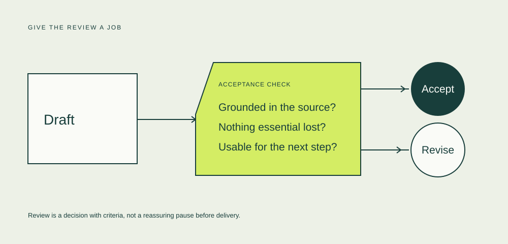

A quick answer is easy to notice. A finished task is harder to define. I want to follow the space between the two, using a deliberately small example: turning a support conversation into a summary that another person can act on.

Everything in this story is hypothetical. The diagrams describe a process to examine, not measured results from a team.

## Start at the other end

Before choosing a model, decide what someone needs from the result. In this example, the next support agent must understand the issue, what has already been tried, and what remains unresolved.

That is our acceptance standard. A short summary is useful only if it preserves those things. The word count, the fluency and the speed of generation are interesting, but none of them establishes that the task is finished.

## The handoff is part of the work

A draft moves from the model to a person. That handoff needs context: where the draft came from, which source it summarizes and what the reviewer is supposed to check.

The person reviewing it is doing a job. Treating their time as a rounding error would hide a part of the process we are trying to understand.

<figure class="story-figure" tabindex="0" aria-label="Acceptance check diagram. Scroll horizontally on small screens.">

</figure>

A useful review has declared criteria and an explicit next action. Scroll the diagram sideways for detail.

The angled entry represents unfinished work. The solid circle marks an accepted result. These are visual conventions for this journal, not a claim that every process is this tidy.

## Count the whole route

Suppose the manual task takes eight minutes. For a simple AI-assisted alternative, suppose the draft takes one minute and review takes four. With one draft and one review, that is five minutes.

Now let the review take eight minutes. The same quick draft produces a nine-minute task. Nothing about the model’s drafting speed changed; the total route did.

The worked example below lets you change that one assumption. It deliberately leaves out retries, setup and other effects, so it can explain a relationship without pretending to forecast a business result.

## Keep the question open

This does not tell us whether AI should be used for the task. It tells us what to inspect in a trial: the complete route to an accepted result.

Watch where the work moves. Keep the standard of acceptance consistent. Give people a way to reject a result that looks convincing but fails the task.

Then ask a more useful question: **did the work become easier to complete, or did one visible step simply become faster?**
